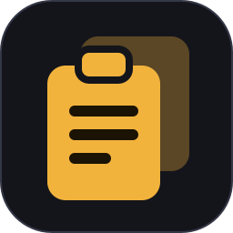
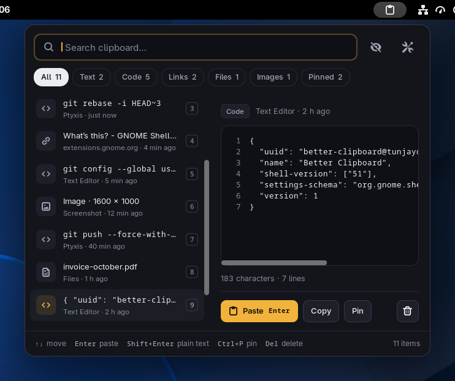
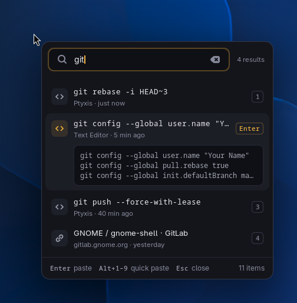
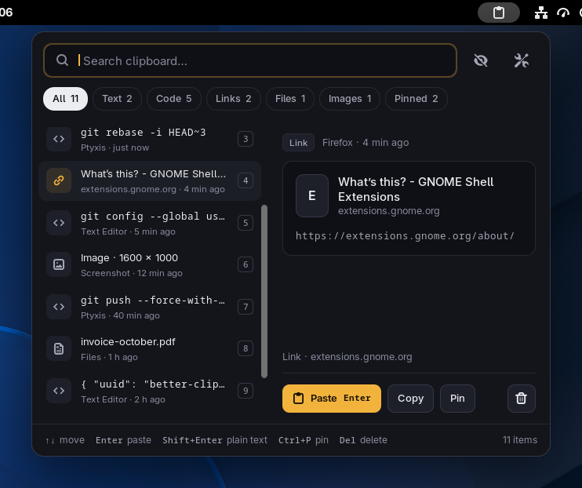
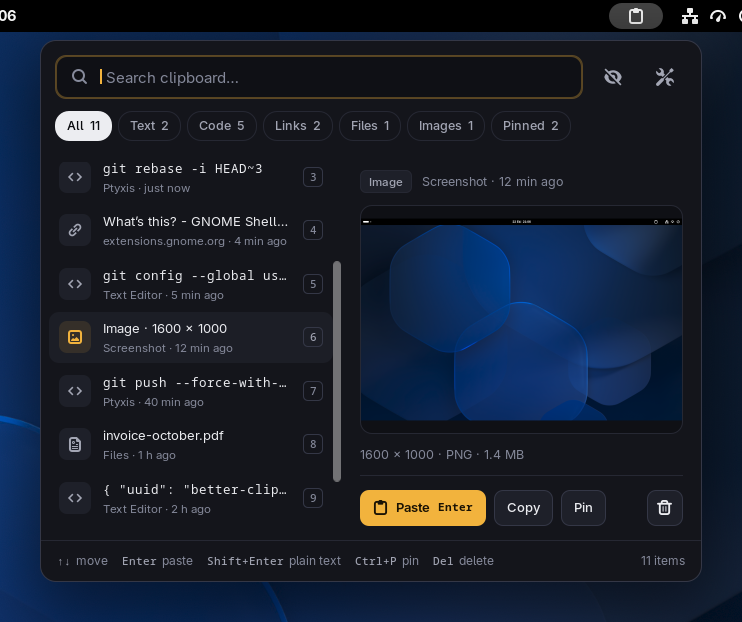
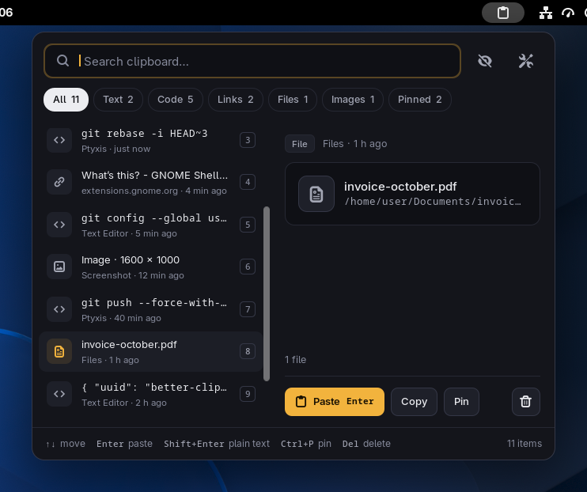
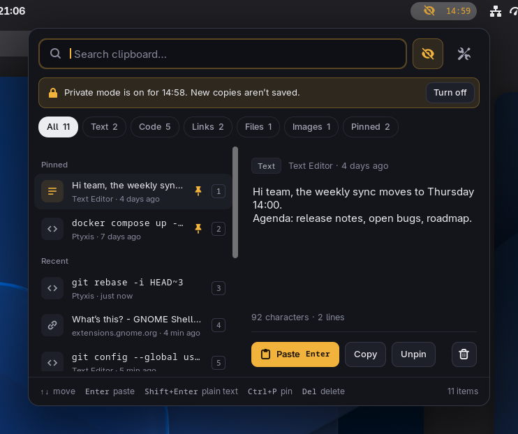
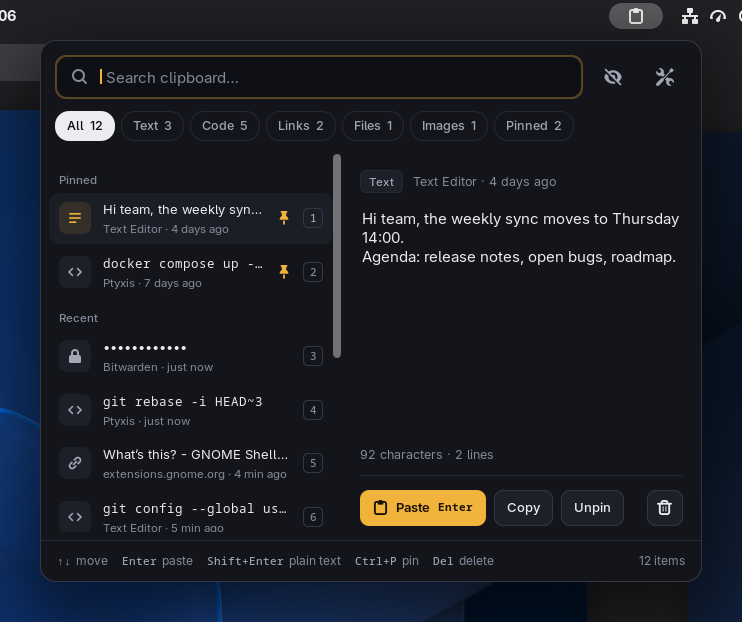
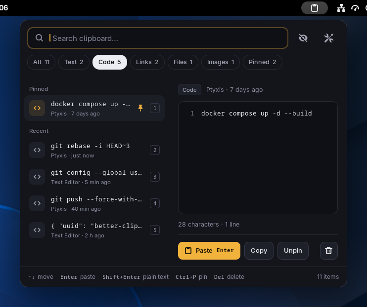
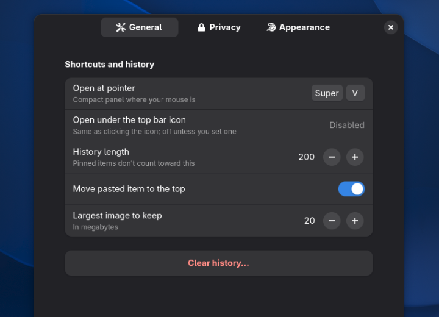

<p align="center">
  
</p>

<h1 align="center">Better Clipboard</h1>

<p align="center">
  <strong>A fast, keyboard-first clipboard history for GNOME Shell.</strong><br>
  Press <kbd>Super</kbd>+<kbd>V</kbd>, find what you copied, press <kbd>Enter</kbd>, and it's pasted.
</p>

<p align="center">
  
  
  
  <a href="LICENSE"></a>
</p>

<p align="center">
  
</p>

Better Clipboard keeps everything you copy (text, code, links, files and images)
and opens it right where you are working. It is a plain GNOME Shell extension:
no background app, no daemon, nothing else to install.

## Why another clipboard manager

On Wayland, only the focused window can read the clipboard, so a normal app
can't keep a history. The shell can. Better Clipboard lives in the shell and
focuses on what the existing extensions do poorly:

- **It opens where your eyes are.** <kbd>Super</kbd>+<kbd>V</kbd> opens a compact panel
  at the mouse pointer. Clicking the top bar icon opens the full panel with a preview.
- **You see the content before you paste it.** Code gets line numbers, links get their page
  title, images get a thumbnail, and files show their full path.
- **The keyboard does everything.** Search as you type, move with the arrows, and paste
  with <kbd>Enter</kbd> or <kbd>Alt</kbd>+<kbd>1</kbd>…<kbd>9</kbd>. Pasting goes straight
  into the app you were using, with <kbd>Ctrl</kbd>+<kbd>Shift</kbd>+<kbd>V</kbd> in terminals.
- **Passwords stay out of it.** Anything a password manager marks as secret, or copies
  from apps you list, is never recorded.

## Screenshots

<table>
  <tr>
    <td width="50%"></td>
    <td width="50%"></td>
  </tr>
  <tr>
    <td><b>At the pointer.</b> <kbd>Super</kbd>+<kbd>V</kbd> opens a compact list where your mouse is. The selected row shows its first lines.</td>
    <td><b>Links</b> show the page title, fetched once when you copy them.</td>
  </tr>
  <tr>
    <td></td>
    <td></td>
  </tr>
  <tr>
    <td><b>Images</b> from screenshots and browsers, with size and format.</td>
    <td><b>Files</b> copied in Files paste back as files, or as paths with <kbd>Shift</kbd>+<kbd>Enter</kbd>.</td>
  </tr>
  <tr>
    <td></td>
    <td></td>
  </tr>
  <tr>
    <td><b>Private mode</b> pauses recording for 15 minutes, an hour, or until you turn it off. The top bar shows the time left.</td>
    <td><b>Sensitive items</b> are masked, kept only in memory and removed on their own, if you let them in at all.</td>
  </tr>
  <tr>
    <td></td>
    <td></td>
  </tr>
  <tr>
    <td><b>Filters</b> for text, code, links, files, images and pinned items. Cycle them with <kbd>Tab</kbd>.</td>
    <td><b>Settings</b> for shortcuts, history length, ignored apps and more.</td>
  </tr>
</table>

## Install

Better Clipboard needs **GNOME Shell 51**.

### From source

```sh
git clone https://github.com/tunjayoff/better-clipboard.git
cd better-clipboard
make install
```

Log out and back in once, since Wayland can't reload the shell in place. Then run:

```sh
gnome-extensions enable better-clipboard@tunjayoff
```

If you use another clipboard extension (Clipboard Indicator, Pano and so on), disable
it, or every copy will be recorded twice.

## Keyboard

| Key | Action |
| --- | --- |
| <kbd>Super</kbd>+<kbd>V</kbd> | Open at the mouse pointer (press again to close) |
| Type | Search everything, including file names and link titles |
| <kbd>↑</kbd> <kbd>↓</kbd> · <kbd>Page Up</kbd> <kbd>Page Down</kbd> | Move |
| <kbd>Enter</kbd> | Paste into the app you were using |
| <kbd>Shift</kbd>+<kbd>Enter</kbd> | Paste as plain text |
| <kbd>Alt</kbd>+<kbd>1</kbd>…<kbd>9</kbd> | Paste the nth item |
| <kbd>Ctrl</kbd>+<kbd>C</kbd> | Copy without pasting |
| <kbd>Ctrl</kbd>+<kbd>P</kbd> | Pin or unpin |
| <kbd>Del</kbd> | Delete (<kbd>Shift</kbd>+<kbd>Del</kbd> while searching) |
| <kbd>Tab</kbd> · <kbd>Shift</kbd>+<kbd>Tab</kbd> | Next or previous filter |
| <kbd>Esc</kbd> | Clear the search, then close |

The full panel under the top bar icon has no shortcut by default. You can give it one
in Settings.

> [!NOTE]
> Stock GNOME also binds <kbd>Super</kbd>+<kbd>V</kbd> to the notification list. While
> Better Clipboard is enabled it takes that one shortcut over, and it gives the
> shortcut back when disabled. <kbd>Super</kbd>+<kbd>M</kbd> keeps opening notifications.

## Privacy

- **Secret content is skipped.** Content marked with the `x-kde-passwordManagerHint: secret`
  clipboard flag (KeePassXC and others) is never saved. Neither is anything copied
  from an app on the ignore list (Bitwarden, KeePassXC and 1Password by default).
- **Or kept briefly.** If you turn that off, sensitive items are masked, never written to
  disk, and removed after 30 seconds (adjustable).
- **History stays on your machine.** It lives in
  `~/.local/share/better-clipboard@tunjayoff/`, readable only by you. You can clear it
  on every log out.
- **Link titles are the only network use.** One request per copied link, which you can
  turn off in Settings.

## Development

```sh
make lint     # syntax check, schema check, unit tests
make zip      # dist/better-clipboard@tunjayoff.shell-extension.zip for extensions.gnome.org
make install  # install into ~/.local/share/gnome-shell/extensions
```

| File | Role |
| --- | --- |
| `extension.js` | Wires everything together |
| `lib/clipboard.js` | Watches the clipboard, reads each change, writes items back, sends the paste keys |
| `lib/history.js` | The list itself: duplicates, pins, limits, expiry, saving |
| `lib/popup.js` | The panel and its keyboard handling |
| `lib/indicator.js` | Top bar icon |
| `lib/shortcuts.js` | Global shortcuts and the <kbd>Super</kbd>+<kbd>V</kbd> hand-off |
| `lib/linkTitle.js` | Fetches page titles for copied links |
| `prefs.js` | Settings window (GTK 4 and libadwaita) |

Testing without logging out works well with a headless nested shell:
`dbus-run-session gnome-shell --headless --wayland --virtual-monitor 1600x1000`,
with `XDG_DATA_HOME` and `XDG_CONFIG_HOME` pointed at a scratch directory so your
own session is untouched.

## License

Better Clipboard is free software, released under the
[GNU General Public License v2.0 or later](LICENSE).
